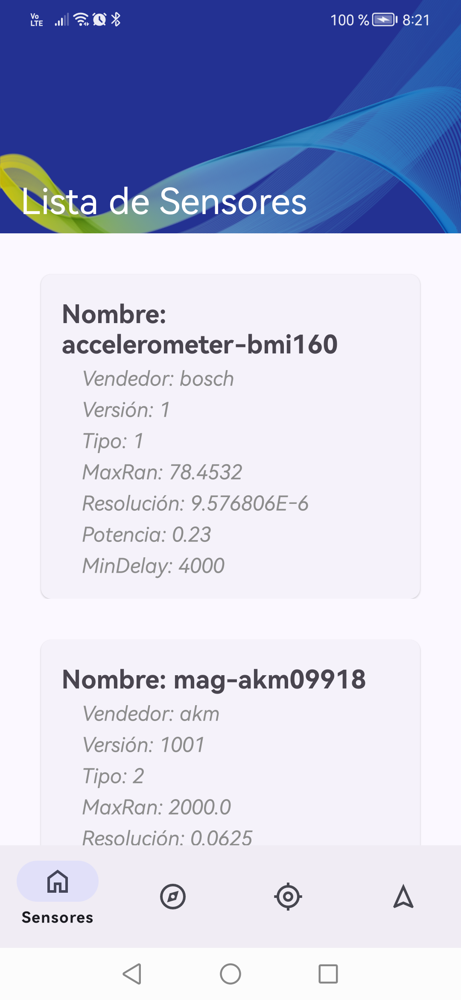
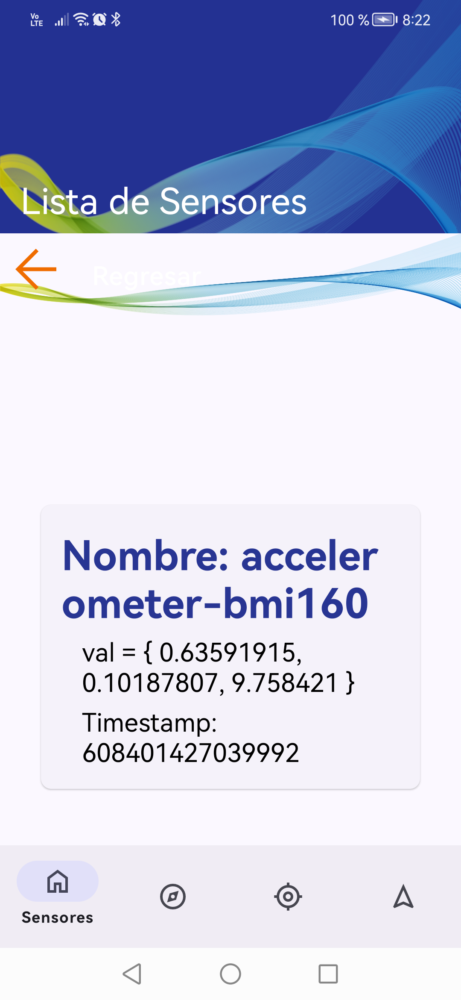
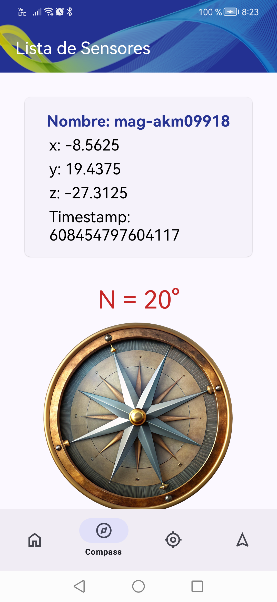
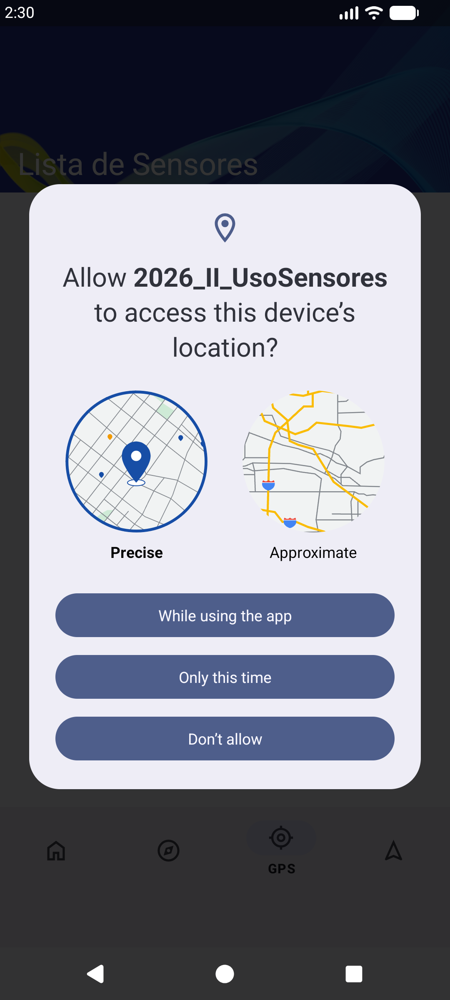
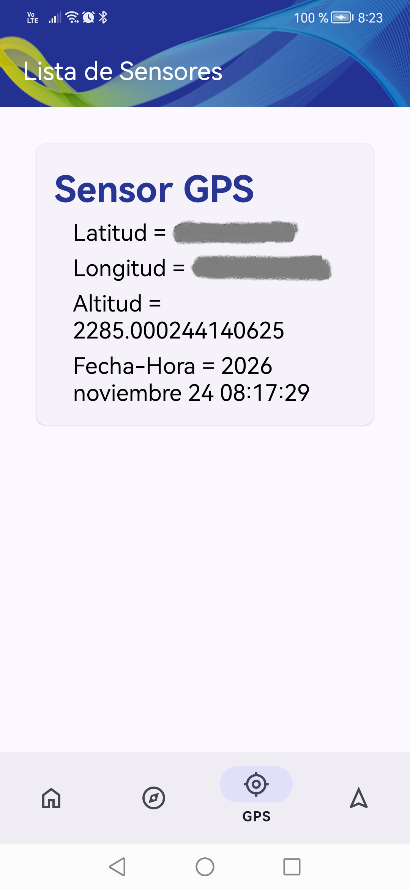
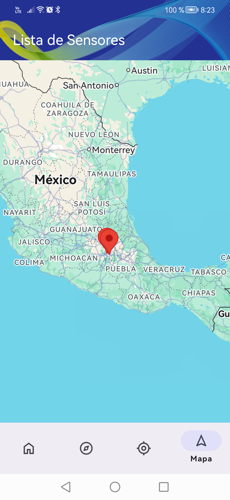

# Ejercicio. Uso de sensores 

En el ejercicio se muestra la forma de leer los sensores en el dispositivo. Emplea fragmentos y una
barra de navegación con cuatro opciones: la primera opción muestra la lista de los sensores que incluye 
el dispositivo, al seleccionar un item, se muestra las lecturas de dicho sensor, sin procesar; 
en la segunda opción, se tiene un fragmento donde ocupa el sensor magnetometro y el de gravedad para
la realización de una brújula, se muestra la lectura del sensor magnético; la tercera opción, 
se hace una lectura del sensor GPS, se incluye la solicitud de permisos en tiempo real pos los datos 
sensibles; finalmente, en la última opción, se incluye un mapa de Google, incluye el sensor GPS para
leer la localización actual y mostrarla con un marcador en el mapa. Para poder ejecutar correctamente 
la aplicación, es necesario que el dispositivo contenga los sensores correspondientes, además para
mostrar el mapa, es necesario tener la clave API generada por Google Cloud.

La aplicación utiliza controles: **BottomNavigationView**, **MaterialCardView**, **MaterialToolbar**,
**ScrollView**, **RecycleView**, **Fragments** y Componetes como: **supportFragmentManager**, **googleMap**,
**googleMap**

    

<b>Figura 1.</b> Captura de pantalla de la Activity principal principal con la lista de sensores en el dispositivo

    

<b>Figura 2.</b> Captura de datos de  un sensor Acelerómetro

    

<b>Figura 3.</b> Captura de pantalla de la opción brújula (Compass)

    

<b>Figura 4.</b> Captura de pantalla para solicitar permisos de localización

    

<b>Figura 5.</b> Captura de pantalla para obtener las coordenadas GPS

    

<b>Figura 6.</b> Captura de pantalla de la opción de mapa

# Enlaces de referencias

1. [Uso de Sensores] (https://developer.android.com/develop/sensors-and-location/sensors/sensors_overview) Descripción general sobre lectura de sensores
2. [Permisos Localización] (https://developer.android.com/develop/sensors-and-location/location/permissions) Configuración de permisos de localización
3. [Leer GPS] (https://developer.android.com/develop/sensors-and-location/location/retrieve-current) Descripción de lectura del sensor GPS
4. [Google Maps] (https://developers.google.com/maps/documentation/android-sdk/start) Descripción general para incorporar  Google Maps al proyecto

